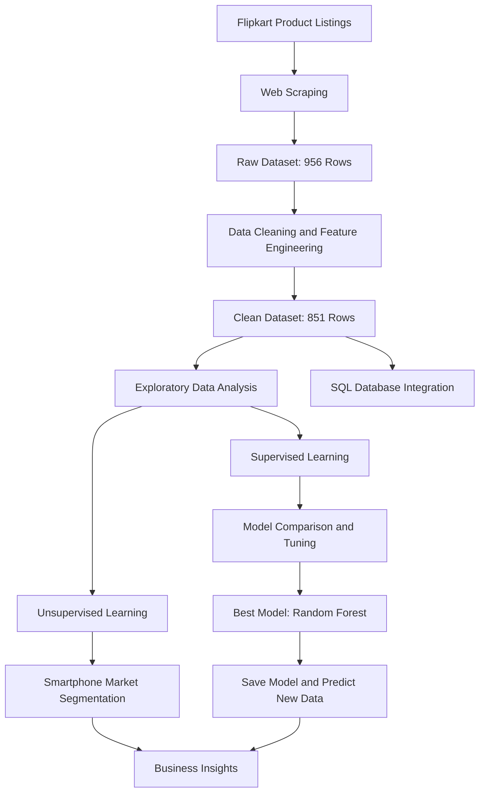

# 📱 Mobile Data Analysis & Brand Prediction Using Machine Learning

<p align="center">
  
  
  
  
  
</p>

<p align="center">
  <b>An End-to-End Data Science Capstone Project</b><br/>
  Turning raw smartphone product data into actionable business insights through web scraping, data analysis, clustering, and machine learning.
</p>

---

## 📌 Project Overview

This project explores the Indian smartphone market by collecting product information from Flipkart and transforming raw web data into meaningful insights using Python, SQL, exploratory data analysis (EDA), and machine learning.

The project follows a complete data science workflow, starting with automated data collection and ending with trained-model predictions and business recommendations.

The main objective is to understand smartphone pricing patterns, brand distribution, customer ratings, and product specifications while building machine learning models that can segment mobile phones and predict their brands.

🔗 **GitHub Repository:** [Web-Scraping-Mobile-Data-Prediction](https://github.com/ParthasarathiAnalytics/Web-Scraping-Mobile-Data-Prediction)

## 🎯 Business Objectives

- Automate smartphone data collection using web scraping.
- Clean and transform raw product data into an analysis-ready dataset.
- Identify brand distribution, price ranges, ratings, and specification trends.
- Analyze relationships between smartphone prices and hardware features.
- Segment smartphones into meaningful market categories using unsupervised learning.
- Compare classification algorithms to predict smartphone brands.
- Tune and save the best-performing model for predictions on new data.
- Translate analytical findings into recommendations for consumers and e-commerce businesses.

## 🛠️ Technology Stack

| Technology | Application |
|---|---|
| Python | Data processing and machine learning |
| Selenium | Browser automation and dynamic webpage loading |
| BeautifulSoup | HTML parsing and product information extraction |
| Pandas & NumPy | Data cleaning, transformation, and analysis |
| Matplotlib & Seaborn | Statistical visualizations and correlation heatmaps |
| SQL & SQLAlchemy | Relational database storage and data retrieval |
| Scikit-learn | Preprocessing, clustering, classification, and evaluation |
| XGBoost | Gradient-boosting classification |
| Pickle | Saving the trained model for reuse |
| Jupyter Notebook | Interactive analysis and experimentation |

## 🔄 End-to-End Project Workflow



## 1. 🕷️ Web Scraping and Data Collection

Smartphone product information was collected from Flipkart using Selenium and BeautifulSoup.

### Information collected

- Product title and brand
- Price and customer rating
- RAM and internal storage (ROM)
- Battery capacity
- Processor information
- Front and rear camera specifications
- Display size and display type
- Warranty and product colour

The scraping workflow included browser setup, pagination, waiting for webpage elements, extracting product specifications, and exporting the collected data to CSV.

**Initial dataset:** 956 rows and 9 columns, as documented in the project report.

## 2. 🧹 Data Cleaning and Feature Engineering

The raw dataset required preprocessing before it could be used for analytics and machine learning.

### Data preparation activities

- Renamed columns for consistency and readability.
- Extracted brand names and processor brands from text fields.
- Separated RAM and ROM values.
- Split combined front and rear camera specifications.
- Removed currency symbols, commas, units, and unwanted strings.
- Converted relevant fields into numeric formats.
- Handled missing ratings and product specifications.
- Removed redundant columns and inconsistent RAM measurements.
- Prepared categorical and numerical features for modeling.

**Final dataset:** 851 rows and 14 columns.

### Final analytical features

`Price`, `Rating`, `RAM`, `ROM`, `Battery`, `Processor`, `Processor_Brand`, `Brand`, `Color`, `Front Camera`, `Back Camera`, `Display Size`, `Display Type`, and `Warranty`.

## 3. 📊 Exploratory Data Analysis (EDA)

EDA was performed to understand smartphone market trends, feature relationships, and pricing behavior.

### Key analytical activities

- Numerical feature correlation heatmap
- Brand-wise product count analysis
- Smartphone price distribution and outlier analysis
- Brand-wise rating comparison
- Analysis of RAM, storage, battery, and processor characteristics
- Visualization of pricing patterns across smartphone categories

### Key findings documented in the project

- Many products in the dataset fall within the ₹10,000–₹20,000 price range.
- Smartphones below ₹8,000 form a budget segment.
- Products priced above ₹40,000 represent the premium segment.
- RAM, storage, processor capability, and battery capacity help differentiate smartphone categories.
- The report identifies Google, Realme, Samsung, and Redmi among the brands frequently represented in the dataset.

*These findings describe the collected dataset and should not be interpreted as a complete measurement of the entire smartphone market.*

## 4. 🗄️ SQL Database Integration

After data cleaning, the processed dataset was transferred to a relational database using SQLAlchemy.

### Workflow

1. Load the cleaned dataset into Pandas.
2. Configure a database connection.
3. Store the processed data in a relational table.
4. Retrieve stored records using SQL queries.
5. Load the retrieved data back into Python for further analysis.

This integration demonstrates how Python-based analytics can work alongside relational database systems to support data management and reusable analytical workflows.

## 5. 🔍 Unsupervised Learning: Smartphone Segmentation

Two clustering algorithms were implemented and compared to discover groups of smartphones with similar characteristics.

| Algorithm | Silhouette Score |
|---|---:|
| K-Means | 0.460 |
| Hierarchical Clustering | 0.461 |
| Tuned Hierarchical Clustering | 0.647 |

The tuned hierarchical clustering model achieved a silhouette score of **0.647**, with the selected cluster count set to 14 in the project report.

### Business-oriented segments

| Segment | Approximate price range | Typical positioning |
|---|---:|---|
| Budget | Below ₹8,000 | Entry-level and affordability-focused |
| Midrange | ₹15,000–₹20,000 | Balanced features and pricing |
| Gaming / Performance | ₹20,000–₹32,000 | Higher RAM and performance-oriented hardware |
| Premium | Above ₹40,000 | Flagship specifications and premium positioning |

These segments support product comparison, inventory planning, and targeted marketing.

## 6. 🤖 Supervised Learning: Smartphone Brand Prediction

A multi-class classification approach was developed to predict a smartphone's brand using its product specifications.

### Model development workflow

- Feature selection and target definition
- Encoding categorical variables
- Filtering very rare target classes
- Train-test splitting
- Feature scaling using StandardScaler
- Cross-validation using StratifiedKFold
- Training and evaluating multiple classification algorithms
- Hyperparameter tuning
- Comparing actual and predicted labels
- Saving the best-performing model for future predictions

### Classification algorithms compared

- Logistic Regression
- Support Vector Machine (SVM)
- K-Nearest Neighbors (KNN)
- Decision Tree
- Random Forest
- XGBoost

### 📈 Model Performance Comparison

The following test accuracies are taken from the project report.

| Model | Training Accuracy | Test Accuracy |
|---|---:|---:|
| Logistic Regression | 83.65% | 75.88% |
| SVM | 68.04% | 66.47% |
| KNN | 82.62% | 71.18% |
| Decision Tree | 100.00% | 90.00% |
| Random Forest | 100.00% | **94.71%** |
| XGBoost | 100.00% | 92.94% |

### Best-performing model: Random Forest

The Random Forest classifier achieved the highest reported test accuracy of approximately **94.71%** before tuning.

The project report further documents hyperparameter tuning that improved accuracy from approximately 92% to 94%.

The trained Random Forest model was saved using Pickle and used to generate predictions for new smartphone data without retraining the model.

> **Important:** The reported accuracy measures how well the model predicts brand labels on the evaluated test dataset. It does not represent smartphone price prediction accuracy or guarantee the same performance on future data.

## 7. 💡 Business Insights and Recommendations

### For e-commerce businesses

- Prioritize analysis of midrange smartphone inventory and demand.
- Compare product prices against RAM, storage, battery, and processor specifications.
- Use brand-wise product counts and ratings to guide merchandising decisions.
- Create targeted promotions for budget, performance, and premium product categories.
- Refresh scraped data periodically to account for changing prices and product availability.

### For consumers

- Compare specifications alongside price rather than relying on brand alone.
- Evaluate battery capacity, RAM, processor performance, camera features, and user ratings against individual needs.
- Compare similar models across brands before making a purchase.
- Consider total value for money when choosing between midrange and premium devices.

### Future enhancements

- Incorporate customer review sentiment analysis.
- Schedule regular data collection and dataset refreshes.
- Add price prediction as a separate regression problem.
- Develop a smartphone recommendation system based on budget and preferred specifications.
- Deploy the trained classification model through a Streamlit or Flask application.
- Monitor model performance on newly collected data.

## 🚀 Getting Started

### Prerequisites

- Python 3.10 or a compatible Python environment
- Google Chrome
- Jupyter Notebook
- A supported relational database if you want to reproduce the SQL integration
- The project source files and required datasets

### Installation

Clone the repository:

```bash
git clone https://github.com/ParthasarathiAnalytics/Web-Scraping-Mobile-Data-Prediction.git
```

Navigate to the project directory:

```bash
cd Web-Scraping-Mobile-Data-Prediction
```

Install the principal Python dependencies:

```bash
pip install pandas numpy matplotlib seaborn scikit-learn selenium beautifulsoup4 webdriver-manager sqlalchemy pymysql xgboost jupyter
```

Launch Jupyter Notebook:

```bash
jupyter notebook
```

Open the relevant notebook or Python script and execute the workflow in sequence.

**Database note:** The SQL connection settings, database credentials, dataset paths, and input feature columns must match your local setup. Do not commit database passwords or other secrets to GitHub.

**Reproducibility note:** The commands above install the main libraries documented for the workflow. Exact execution steps depend on the files and database configuration included in the repository.

## 📁 Project Structure

The repository's exact file structure should be reflected here after verification. A suggested organization for this project is:

```text
Web-Scraping-Mobile-Data-Prediction/
│
├── notebooks/          # Scraping, EDA, and ML notebooks
├── data/               # Raw and cleaned datasets
├── models/             # Saved trained model
├── visualizations/     # EDA and model comparison charts
├── README.md
└── requirements.txt
```

*This is a recommended structure, not a verified listing of the current repository files.*

## 🎓 Skills Demonstrated

- Python programming for data science
- Dynamic website scraping and HTML parsing
- Data cleaning and feature engineering
- Exploratory data analysis and visualization
- SQL database integration
- Unsupervised learning and clustering evaluation
- Multi-class classification
- Model comparison and hyperparameter tuning
- Model persistence and prediction on new data
- Translating analytical results into business recommendations

## 👨‍💻 Author

**Parthasarathi A**

Data Analytics | Data Science | Python | SQL | Machine Learning

- GitHub: [@ParthasarathiAnalytics](https://github.com/ParthasarathiAnalytics)
- Project Repository: [Web Scraping Mobile Data Prediction](https://github.com/ParthasarathiAnalytics/Web-Scraping-Mobile-Data-Prediction)
- Portfolio: [parthasarathi-analytics.vercel.app](https://parthasarathi-analytics.vercel.app/)

## 📜 Responsible Data Collection

This project was developed for educational and analytical purposes. Website content, prices, and product specifications may change over time. Before collecting data, review the website's terms of service, applicable policies, and access restrictions. Use reasonable request rates and do not attempt to bypass access controls.

---

<p align="center">
  <b>From Raw Data to Business Insights — An End-to-End Data Science Journey.</b>
</p>
